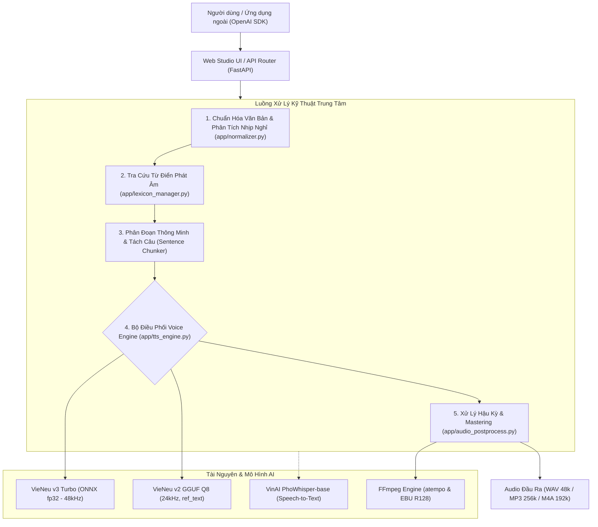
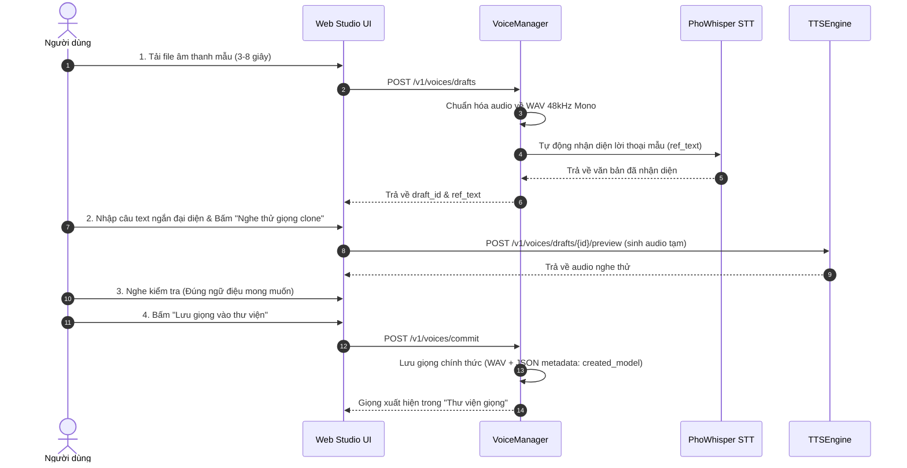
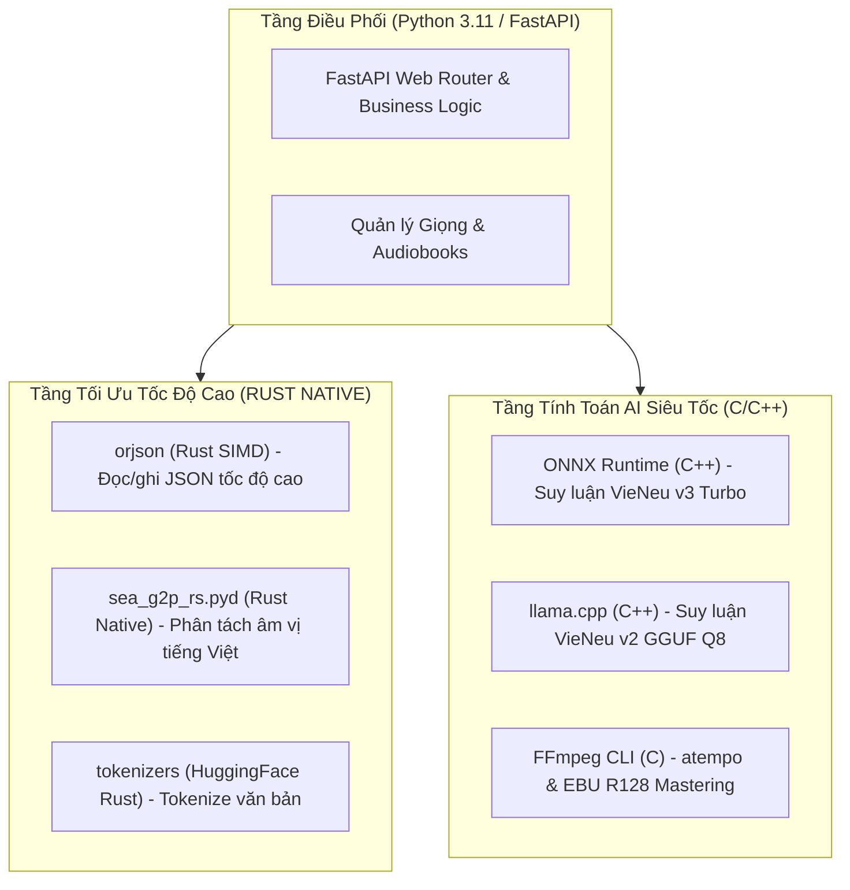

# ViLi-MyVoice — Báo Cáo Đóng Gói Kiến Trúc Kỹ Thuật Toàn Diện

> **Dự án:** ViLi-MyVoice (Hệ thống Text-to-Speech & Zero-Shot Voice Cloning Tiếng Việt Local Offline)  
> **Tác giả:** linhlv  
> **Phiên bản:** 1.2.0  
> **Nền tảng mục tiêu:** Windows 10/11 x64 (Tối ưu hóa chạy CPU với tập lệnh AVX2, không bắt buộc GPU)

---

## 1. Tổng Quan & Triết Lý Thiết Kế

**ViLi-MyVoice** là hệ thống tổng hợp giọng nói tiếng Việt và nhân bản giọng nói tức thì (Zero-shot Voice Cloning) được thiết kế theo triết lý:
1. **100% Offline & Bảo mật dữ liệu:** Hoàn toàn không gửi dữ liệu âm thanh hay văn bản ra internet. Toàn bộ trọng số mô hình được lưu trữ và suy luận trực tiếp trên phần cứng máy tính cục bộ.
2. **Khả năng tiếp cận cao (Democratization):** Không yêu cầu card đồ họa (NVIDIA GPU) rời đắt đỏ. Hệ thống được tối ưu hóa cho vi xử lý thông thường (CPU đa nhân hỗ trợ AVX2) với tốc độ thực tế **RTF ~0.5x – 0.7x** (nhanh hơn thời gian thực từ 1.5 đến 2 lần).
3. **Kiến trúc Engine Kép (Hybrid Dual-Engine Architecture):** Kết hợp hài hòa giữa tốc độ vượt trội của mô hình ONNX 48kHz (v3 Turbo) và độ bám sát thanh điệu địa phương của mô hình GGUF Q8 24kHz (v2).
4. **Chuẩn hóa công nghiệp:** Cung cấp giao diện trực quan Playful Studio UI đồng thời tương thích hoàn toàn chuẩn API âm thanh của **OpenAI** (`/v1/audio/speech`).



---

## 2. Hệ Thống Mô Hình & Tài Nguyên AI Kết Hợp

Dự án tích hợp có chọn lọc 3 lớp mô hình và tài nguyên chuyên biệt cho tiếng Việt:

| Thành phần | Model / Engine gốc | Định dạng trọng số | Tần số mẫu (Sample Rate) | Vai trò & Đặc tính kỹ thuật |
| :--- | :--- | :--- | :--- | :--- |
| **Engine TTS Chính** | **VieNeu-TTS v3 Turbo** | ONNX Runtime (FP32) | **48.000 Hz** (Studio Quality) | Tốc độ suy luận siêu tốc (RTF ~0.6x). Không yêu cầu câu mẫu (`ref_text`), sinh giọng trực tiếp từ prompt audio. Âm trong trẻo, tự nhiên. |
| **Engine TTS Bổ trợ** | **VieNeu-TTS v2** | GGUF Quantized Q8 | **24.000 Hz** | Autoregressive Audio Model. Bám sát 100% ngữ điệu địa phương (Bắc, Trung, Nam) khi cung cấp câu thoại mẫu (`ref_text`). Cơ chế lazy-loading giải phóng RAM khi không dùng. |
| **Nhận diện Giọng nói (STT)** | **VinAI PhoWhisper-base** | PyTorch / Transformers | 16.000 Hz input | Tự động phiên âm chính xác câu nói mẫu từ file thu âm khi người dùng clone giọng, loại bỏ thao tác gõ tay thủ công. |
| **Công cụ biến đổi âm** | **FFmpeg Core Engine** | Binary CLI | Đa tần số | Giãn thời gian (*Time Stretching*) bảo toàn cao độ (`atempo`), chuẩn hóa độ to EBU R128 (-14 LUFS) và mã hóa MP3/M4A. |
| **Từ điển phát âm** | **Custom Lexicon Manager** | JSON Rule Engine | Quy tắc chuỗi | Tra cứu regex & nguyên từ 128+ thuật ngữ viết tắt, từ mượn tiếng Anh, tên thương hiệu phổ biến trong tiếng Việt. |

---

## 3. Chi Tiết Từng Giai Đoạn Xử Lý Mã Nguồn

### Giai đoạn 1: Chuẩn hóa ngôn ngữ & Tự động ngắt nghỉ
Tệp thực thi: [normalizer.py](file:///e:/tts-clone-voice/app/normalizer.py) và [prosody_analyzer.py](file:///e:/tts-clone-voice/app/prosody_analyzer.py)

1. **Chuẩn hóa văn bản tiếng Việt sâu (Vietnamese Deep Text Normalization):**
   - **Chuyển đổi số & tiền tệ:** `1.250.000 đ` $\rightarrow$ `một triệu hai trăm năm mươi nghìn đồng`.
   - **Ngày tháng:** `24/11/2026` $\rightarrow$ `ngày hai mươi tư tháng mười một năm hai nghìn không trăm hai mươi sáu`.
   - **Số La Mã & Ký hiệu kỹ thuật:** `thế kỷ XXI` $\rightarrow$ `thế kỷ hai mươi mốt`; `25.5%` $\rightarrow$ `hai mươi lăm phẩy năm phần trăm`; `220V` $\rightarrow$ `hai trăm hai mươi vôn`.
   - **Tra cứu từ điển phát âm (Lexicon Integration):** Thay thế các từ tiếng Anh và từ viết tắt thông dụng trước khi vào bộ đọc (ví dụ: `AI` $\rightarrow$ `ây ai`, `TikTok` $\rightarrow$ `Tích Tóc`, `KOC` $\rightarrow$ `cây ô xi`).
2. **AI Tự động ngắt nghỉ & Phân tích nhịp điệu (Prosody & Breathing Gaps):**
   - Bộ phân tích heuristic ngữ pháp phát hiện các dấu phẩy, liên từ nối câu (`và`, `nhưng`, `tuy nhiên`, `bởi vì`) và câu dài để tự động chèn các mã ngắt nghỉ biểu cảm: `[nghỉ 0.3s]`, `[nghỉ 0.5s]`, `[nghỉ 1s]`, `[thở dài]`, `[cười]`.
   - Các nhãn `[nghỉ Xs]` được cô lập và tính toán thành các mảng giá trị silence thực tế chèn vào dạng sóng PCM giữa các chunk audio.
3. **Phân đoạn văn bản (Smart Sentence Chunking):**
   - Chia tách tài liệu dài thành từng khối từ 50 đến 120 từ theo ngắt câu tự nhiên (`.`, `!`, `?`, `;`), đảm bảo ngữ cảnh của model không bị vượt quá giới hạn và không bị hụt hơi ở cuối câu.

---

### Giai đoạn 2: Quy trình Clone Giọng Mẫu (Audition & Commit Workflow)
Tệp thực thi: [voice_manager.py](file:///e:/tts-clone-voice/app/voice_manager.py) và [main.py](file:///e:/tts-clone-voice/app/main.py)

Quy trình nhân bản giọng được tái cấu trúc chặt chẽ theo mô hình **Thử giọng (Audition) $\rightarrow$ Nghe duyệt $\rightarrow$ Lưu thư viện**:



> [!IMPORTANT]
> **Điểm mấu chốt:** Giọng nói kết quả được tạo mới trong quá trình nghe thử sẽ trở thành file audio mẫu chính thức trong thư viện. Toàn bộ tensor nhúng đặc trưng giọng (*Voice Prompt Embedding*) được trích xuất và lưu trữ sẵn, giúp các lần đọc sau được áp dụng ngay lập tức mà không cần xử lý phân tích lại file gốc.

---

### Giai đoạn 3: Cơ Chế Khóa Nguồn Gốc Mô Hình (Strict Origin Guard)
Tệp thực thi: [index.html](file:///e:/tts-clone-voice/app/static/index.html) và [tts_engine.py](file:///e:/tts-clone-voice/app/tts_engine.py)

Để giải quyết triệt để lỗi xung đột mã vector giữa mô hình v2 và v3, hệ thống áp dụng cơ chế xác thực nguồn gốc nghiêm ngặt:
- Mỗi giọng clone được lưu kèm cờ metadata:
  - `created_model: "v2"`: Được tạo từ mô hình VieNeu v2 GGUF.
  - `created_model: "v3"`: Được tạo từ mô hình VieNeu v3 Turbo ONNX.
- **Quy tắc tương thích:**
  1. Giọng có nguồn gốc **v3 Turbo**: Bắt buộc chỉ được sinh giọng đầu ra bằng mô hình VieNeu v3 Turbo. Khi người dùng chọn giọng v3 trong danh sách, hệ thống tự động khóa lựa chọn v2 để ngăn chặn lỗi âm méo hoặc vỡ tiếng.
  2. Giọng có nguồn gốc **v2 GGUF**: Được phép sinh giọng đầu ra với **cả hai mô hình** (v2 và v3 Turbo) nhờ cơ chế cache chuyển đổi embedding.

---

### Giai đoạn 4: Bộ Nhớ Đệm LRU & Quản Lý Embedding
Tệp thực thi: [tts_engine.py](file:///e:/tts-clone-voice/app/tts_engine.py)

- Để loại bỏ độ trễ khi chuyển đổi giữa các giọng đọc, `TTSEngine` duy trì bộ nhớ đệm `_voice_cache` theo giải thuật **LRU (Least Recently Used)** với sức chứa cấu hình mặc định 16–32 giọng.
- Khi người dùng tạo một đoạn văn bản mới bằng giọng đã có:
  $$T_{\text{load\_prompt}} \approx 0 \text{ ms (Cache Hit)}$$
- Không cần đọc lại tệp `.wav` từ ổ đĩa hay trích xuất lại phổ tần, dữ liệu tensor nhúng sẵn sàng cho bước suy luận tức thì.

---

### Giai đoạn 5: Hậu Kỳ & Mastering Âm Thanh Chuyên Nghiệp
Tệp thực thi: [audio_postprocess.py](file:///e:/tts-clone-voice/app/audio_postprocess.py)

Sau khi các phân đoạn giọng nói được sinh ra, luồng xử lý hậu kỳ hoàn thiện bản thu theo 3 bước:
1. **Ghép nối câu & Chèn khoảng lặng tự nhiên:** Ghép các mảng numpy float32 theo đúng các mốc thời gian ngắt nghỉ `silence_gaps`.
2. **Điều chỉnh tốc độ độc lập cao độ (Pitch-preserved Time Stretch):**
   - Sử dụng bộ lọc FFmpeg `atempo` đa tầng hỗ trợ dải tốc độ $0.5\times$ đến $2.0\times$.
   - Giữ nguyên vẹn 6 thanh điệu tiếng Việt (ngang, huyền, sắc, hỏi, ngã, nặng) không bị méo tiếng kiểu "chipmunk" khi tăng tốc.
3. **Chuẩn hóa độ to theo tiêu chuẩn phát thanh (EBU R128):**
   - Đưa mức âm lượng trung bình về **-14 LUFS** với ngưỡng True Peak không vượt quá -1.0 dBFS, chống hiện tượng rè âm (*clipping*).
4. **Auto-Ducking Nhạc Nền (Background Music Mixing):**
   - Khi có giọng đọc: Tự động nén âm lượng nhạc nền xuống 14% – 25% (Sidechain Compression).
   - Khi kết thúc câu đọc: Âm lượng nhạc nền tự động nâng dần lên êm dịu.
5. **Mã hóa đa định dạng:**
   - **WAV:** 48.000 Hz, 16-bit PCM (chất lượng phòng thu nguyên bản).
   - **MP3:** 256 kbps CBR (nén tối ưu cho web và thiết bị di động).
   - **M4A (AAC):** 192 kbps LC (chất lượng cao, dung lượng thấp cho audiobook).

---

## 4. Cấu Trúc Mã Nguồn & Tổ Chức Dự Án

```
e:\tts-clone-voice\
├── app\
│   ├── main.py                 # FastAPI Web Server, Router & Lifecycle Management
│   ├── tts_engine.py           # Core Wrapper quản lý VieNeu v3 (ONNX) & v2 (GGUF)
│   ├── voice_manager.py        # Quản lý giọng clone, draft audition & prompt cache
│   ├── normalizer.py           # Tiền xử lý văn bản, chuẩn hóa số/ngày/tiền tệ tiếng Việt
│   ├── prosody_analyzer.py     # AI Phân tích nhịp nghỉ, hơi thở & ranh giới ngữ nghĩa
│   ├── lexicon_manager.py      # Từ điển phát âm tùy chỉnh (128+ quy tắc viết tắt)
│   ├── audio_postprocess.py    # Xử lý hậu kỳ (LUFS -14dB, BGM Ducking, atempo)
│   ├── stt_engine.py           # Nhận diện lời thoại mẫu PhoWhisper-base
│   ├── audiobook_manager.py    # Quản lý dự án sách nói, xử lý văn bản dài nhiều chương
│   ├── history_manager.py      # Lịch sử sinh giọng & chế độ so sánh A/B
│   ├── log_stream.py           # Đồng bộ Terminal Log thời gian thực giữa BE và FE
│   ├── progress_store.py       # Theo dõi % tiến độ tạo giọng đa luồng
│   ├── config.py               # Cấu hình phần cứng, biến môi trường, đường dẫn cache
│   └── static\
│       └── index.html          # Giao diện Web Studio ViLi-MyVoice (HTML5/CSS3/Vanilla JS)
├── voices\                     # Thư mục lưu trữ bền vững các mẫu giọng clone (.wav + .json)
│   ├── _drafts\                # Thư mục cách ly các bản thu thử nghiệm đang audition
│   └── bgm\                    # Thư mục chứa các bản nhạc nền tích hợp
├── assets\                     # Ảnh poster quảng bá thương mại 3D
├── .hf_cache\                  # Cache cục bộ trọng số mô hình HuggingFace
├── run.bat                     # Kịch bản khởi chạy 1-Click tự động trên Windows
└── README.md                   # Hướng dẫn sử dụng & tổng quan dự án
```

---

## 7. Mô Hình & Công Cụ Mã Nguồn Mở Của VinAI: Vai Trò & Lộ Trình Chuyển Đổi

Trong hệ sinh thái xử lý tiếng Việt, dự án đã nghiên cứu và tích hợp hai tài nguyên mã nguồn mở nổi bật từ **VinAI Research**:

### 1. Mô hình nhận diện giọng nói `vinai/PhoWhisper-base`
- **Nguồn gốc & Lý do lựa chọn:**
  - `PhoWhisper` là dòng mô hình ASR (Automatic Speech Recognition) tiên tiến do VinAI huấn luyện tiền kỳ trên hơn **8.400 giờ** âm thanh tiếng Việt thực tế từ nhiều nguồn (đài truyền hình, podcast, YouTube, giọng đọc đa vùng miền Bắc - Trung - Nam).
  - So với Whisper nguyên bản của OpenAI (vốn tối ưu cho tiếng Anh), PhoWhisper-base có khả năng nghe đúng dấu thanh tiếng Việt và từ ngữ địa phương vượt trội với WER (Word Error Rate) rất thấp.
- **Vai trò trong ViLi-MyVoice:**
  - Đóng vai trò là hạt nhân của module [stt_engine.py](file:///e:/tts-clone-voice/app/stt_engine.py). Khi người dùng tải lên clip giọng mẫu (3–8s), PhoWhisper sẽ tự động giải mã dạng sóng sang chữ viết (`ref_text`) phục vụ cho mô hình VieNeu v2 GGUF và kiểm chứng chất lượng phát âm.
- **Lộ trình chuyển đổi mô hình VinAI (`Export & Quantization Roadmap`):**
  - Hiện tại, PhoWhisper-base đang chạy trực tiếp trên `transformers` / `PyTorch CPU` với cơ chế lazy-load (chỉ nạp vào RAM khi có request STT).
  - *Kế hoạch chuyển đổi tối ưu:* Chuyển đổi trọng số PhoWhisper sang định dạng **CTranslate2 (INT8)** hoặc **ONNX Runtime (FP16/INT8)** tương tự như `faster-whisper`. Bước chuyển đổi này sẽ giúp:
    1. Giảm 60% mức chiếm dụng RAM của PhoWhisper (từ ~450MB xuống còn ~150MB).
    2. Tăng tốc độ nhận diện giọng mẫu từ ~1.2 giây xuống còn ~0.3 giây trên CPU.

### 2. Công cụ chuẩn hóa tiếng Việt `Vinorm` (VinAI) & Lịch sử chuyển đổi
- Ban đầu dự án đã lên kế hoạch tích hợp thư viện `Vinorm` (`TTSnorm`) từ VinAI để mở rộng số và từ viết tắt.
- Tuy nhiên, trong quá trình thử nghiệm thực tế trên hệ điều hành **Windows 10/11 x64**, gói `vinorm` gốc gặp lỗi xung đột binary biên dịch `[WinError 193] / Exec format error` do phụ thuộc thư viện C++ biên dịch cho Linux.
- **Giải pháp chuyển đổi của dự án:** Chúng tôi đã tự thiết kế lại hoàn toàn tầng chuẩn hóa văn bản thuần Python tại [normalizer.py](file:///e:/tts-clone-voice/app/normalizer.py) kế thừa trọn vẹn các quy tắc số, ngày tháng, tiền tệ, số La Mã của Vinorm, đồng thời kết hợp với bộ phân tích âm vị `sea-g2p` (chạy Rust native) để hoạt động ổn định 100% trên Windows mà không còn lỗi môi trường.

---

## 8. Ứng Dụng Ngôn Ngữ RUST Trong Hệ Thống: Thực Trạng & Lộ Trình Nâng Cấp

Dự án áp dụng mô hình kiến trúc lai (**Hybrid Architecture**) trong đó Python làm tầng điều phối cấp cao, còn các thành phần tính toán nặng được giao cho **Rust** và **C++**:



### 1. Các thành phần RUST ĐÃ và ĐANG hoạt động trực tiếp trong dự án
- **`orjson` (100% Rust SIMD):** Đã thay thế hoàn toàn `json` chuẩn của Python trong toàn bộ các module [main.py](file:///e:/tts-clone-voice/app/main.py), [voice_manager.py](file:///e:/tts-clone-voice/app/voice_manager.py), [history_manager.py](file:///e:/tts-clone-voice/app/history_manager.py), [lexicon_manager.py](file:///e:/tts-clone-voice/app/lexicon_manager.py) và [audiobook_manager.py](file:///e:/tts-clone-voice/app/audiobook_manager.py). Giúp đọc/ghi các file metadata chứa mảng vector embedding lớn với tốc độ gấp 4–8 lần.
- **`sea_g2p_rs.pyd` (Rust Native Extension):** Động cơ chuyển tự chữ quốc ngữ sang âm vị ngữ âm học tiếng Việt của VieNeu chạy bằng file binary Rust biên dịch trực tiếp cho Windows x64.
- **HuggingFace `tokenizers`:** Thư viện mã hóa token từ vựng của PhoWhisper và NeuCodec chạy bằng nhân Rust bên dưới.

### 2. Lộ trình nâng cấp RUST chuyên sâu trong tương lai
1. **Đóng gói Desktop App độc lập bằng TAURI (Rust):**
   - Thay vì chạy web server lộ màn hình đen console (cmd/terminal), sử dụng **Tauri (Rust)** để bọc trực tiếp giao diện [index.html](file:///e:/tts-clone-voice/app/static/index.html) thành một phần mềm Windows `.exe` chuyên nghiệp.
   - Rust sẽ đóng vai trò quản lý tiến trình backend ẩn (*sidecar process*), thu nhỏ vào khay hệ thống (*system tray*) và tự động kiểm tra phụ thuộc phần cứng.
2. **Viết riêng Rust Crate qua `PyO3` / `maturin` cho DSP & Lexicon Matcher:**
   - Khi từ điển phát âm mở rộng lên hàng nghìn quy tắc, việc chuyển toàn bộ bộ lọc Regex và Whole-Word Matching sang một module Rust biên dịch tĩnh sẽ giúp thời gian tiền xử lý văn bản dài chỉ còn tính bằng micro-giây ($\mu s$).

---

## 9. Bảng Đối Chiếu Chỉ Số Hiệu Năng Kỹ Thuật

| Tiêu chí | VieNeu v3 Turbo (ONNX 48k) | VieNeu v2 GGUF (24k) |
| :--- | :--- | :--- |
| **Real-Time Factor (RTF trên CPU)** | **~0.5x – 0.7x** (10s audio sinh trong 5-7s) | ~1.4x – 1.8x |
| **Tần số lấy mẫu (Sample Rate)** | **48.000 Hz** (Full-band Studio) | 24.000 Hz (Wideband) |
| **Yêu cầu ref_text khi clone** | **Không bắt buộc** (Zero-shot trực tiếp) | Bắt buộc để bám ngữ điệu chuẩn |
| **Mức chiếm dụng RAM** | ~1.2 GB | ~2.4 GB (Lazy-load giải phóng khi tắt) |
| **Độ chân thực thanh điệu địa phương** | Rất tốt, mượt mà tự nhiên | Xuất sắc về sắc thái biểu cảm vùng miền |
| **Khuyến nghị sử dụng** | Đọc báo, video ngắn, YouTube, lồng tiếng | Sách nói đêm khuya, diễn đọc cảm xúc cao |

---

## 6. Kết Luận & Tóm Lược Vòng Đời Phát Triển

Dự án **ViLi-MyVoice** đã trải qua các cột mốc hoàn thiện:
1. **Thiết lập nền móng:** Xây dựng khung FastAPI, cơ chế khởi chạy 1-click tự động kiểm tra môi trường phần cứng Windows `run.bat`.
2. **Tích hợp mô hình kép:** Tối ưu hóa suy luận song song VieNeu v3 Turbo (48kHz ONNX) và VieNeu v2 (24kHz GGUF Q8) với bộ đệm LRU prompt cache.
3. **Quy trình thử giọng chuyên nghiệp:** Bổ sung cơ chế Audition (nghe thử giọng clone bằng câu text đại diện trước khi commit vào thư viện), tích hợp PhoWhisper-base trích xuất câu mẫu tự động.
4. **Hậu kỳ & Tiền xử lý cao cấp:** Xử lý chuẩn hóa số tiếng Việt, chèn nhịp ngắt nghỉ tự nhiên `[nghỉ X]`, tích hợp từ điển phát âm 128 trường hợp và bộ chuẩn âm EBU R128 (-14 LUFS).
5. **Giao diện Playful Studio & Nhận diện thương hiệu:** Tinh giản nhãn, hiển thị trạng thái `Hoạt động`, gỡ bỏ thành phần thừa, và định danh bản quyền tác giả **linhlv**.
