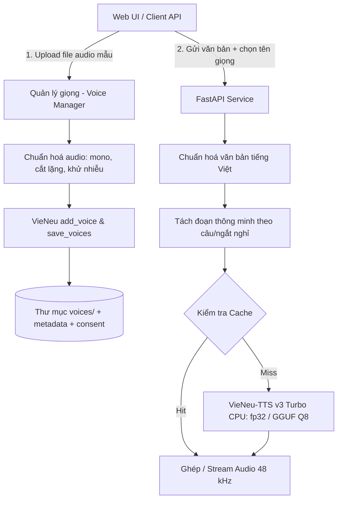

# Kế hoạch triển khai hệ thống TTS Clone Voice tiếng Việt chạy local

## 1. Mục tiêu và phạm vi dự án

Xây dựng công cụ Text-to-Speech (TTS) & Voice Cloning tiếng Việt chạy **hoàn toàn local trên Windows**:

- **Đầu vào:**
  1. File audio giọng mẫu được người dùng upload (không dùng micro, không dùng Speech-to-Text).
  2. Văn bản tiếng Việt (ngắn hoặc dài, có thể xen số, ngày tháng, tiền tệ, từ viết tắt và từ tiếng Anh phổ thông) truyền qua giao diện web hoặc API.
- **Đầu ra:** Audio tiếng Việt (48 kHz WAV hoặc luồng PCM) đọc đúng nội dung văn bản bằng **chính giọng đã clone**, giữ đúng 6 thanh điệu tiếng Việt và có thể dùng cho mục đích thương mại.

**Những thành phần đã loại bỏ khỏi phạm vi để dự án gọn và tập trung tối đa vào chất lượng clone:**
- Không dùng micro, không STT (`sherpa-onnx`, `faster-whisper`), không LLM, không framework hội thoại (`Pipecat`, `LiveKit`).
- Không dùng `Edge TTS` (không clone được, không có quyền thương mại, phụ thuộc mạng).
- Không dùng `Piper` (không clone được).

---

## 2. Thông số phần cứng và ràng buộc cứng

Thông số máy triển khai (lấy từ DxDiag ngày 2026-11-16):

| Thành phần | Thông số |
| --- | --- |
| Hệ điều hành | Windows 10 Pro for Workstations 64-bit (Build 19045) |
| CPU | Intel Xeon E3-1245 v3 @ 3.40GHz (Haswell, 4 nhân / 8 luồng) |
| Tập lệnh CPU | Có AVX2, **không có VNNI** |
| RAM | 16 GB |
| GPU | NVIDIA GeForce GTX 1050 (Pascal), **VRAM dedicated 2 GB** |

**Ràng buộc rút ra từ phần cứng:**
1. **VRAM 2 GB không chạy được các model TTS clone nặng trên GPU local** (`F5-TTS`, `VoxCPM2`, `viXTTS`). Mọi suy luận TTS trên máy này chạy trên **CPU**.
2. **CPU Haswell không có VNNI:** `int8` trên ONNX có rủi ro gây rè hoặc méo âm sắc (làm giảm độ giống của giọng clone). Vì dự án không bị ép độ trễ hội thoại micro realtime, **ưu tiên chất lượng sạch tiếng (`fp32` hoặc `GGUF Q8`)** thay vì đánh đổi sang `int8`.
3. **Tác vụ tuần tự 1 người dùng:** Tối ưu cho việc tạo audio từ văn bản truyền vào (hỗ trợ đọc văn bản dài bằng cách tách câu và ghép nối mượt mà), không thiết kế cho nhiều luồng đồng thời.
4. **Hiệu năng thực tế (RTF):** Phải đo trực tiếp trên chính CPU Xeon E3-1245 v3 trong quá trình triển khai, không dùng số liệu trên phần cứng khác.

---

## 3. Lựa chọn công nghệ cốt lõi

### 3.1. Thành phần được chọn

| Thành phần | Lựa chọn | Vai trò & Lý do |
| --- | --- | --- |
| **TTS & Voice Clone duy nhất** | [VieNeu-TTS v3 Turbo](https://github.com/pnnbao97/VieNeu-TTS) ([model Hugging Face](https://huggingface.co/pnnbao-ump/VieNeu-TTS-v3-Turbo)) | Thuần tiếng Việt (có hỗ trợ chêm từ tiếng Anh), xuất audio **48 kHz**, hỗ trợ instant clone (3–8s), hỗ trợ LoRA fine-tune, chạy CPU không cần PyTorch, licence **Apache-2.0**. |
| **Bộ phiên âm (G2P)** | [eSpeak NG](https://github.com/espeak-ng/espeak-ng/releases) (bản `.msi` Windows) | Thành phần bắt buộc để VieNeu phiên âm tiếng Việt và từ tiếng Anh xen kẽ trên Windows. |
| **Chuẩn hoá văn bản** | `sea-g2p` (tích hợp sẵn trong `vieneu`) + [normalizer.py](app/normalizer.py) | Đọc đúng số, ngày tháng, tiền tệ, đơn vị đo, viết tắt bằng thuần Python trên Windows (thay cho `vinorm` gốc bị lỗi `[WinError 193]` trên Windows). |
| **Xử lý audio mẫu** | `soundfile`, `numpy` (+ chức năng `denoise` tích hợp của VieNeu) | Kiểm tra định dạng, đưa về mono, cắt khoảng lặng thừa, làm sạch file upload trước khi clone. |
| **API Server & Web UI** | `FastAPI` + `Uvicorn` + giao diện web nhẹ (HTML/JS tĩnh phục vụ trực tiếp từ FastAPI) | Giao diện upload file giọng mẫu, chọn giọng, nhập text, nghe trực tiếp và tải file `.wav`; kèm API chuẩn OpenAI-compatible. |

### 3.2. Các phương án clone tiếng Việt đã loại khỏi chạy local trên máy này

| Phương án | Lý do loại |
| --- | --- |
| **F5-TTS bản Việt / EraX viF5TTS / ZipVoice-2500h** | Cần GPU VRAM lớn, không chạy kịp trên CPU/GTX 1050 2GB; licence `CC-BY-NC-SA` (phi thương mại). Chỉ dùng để tham khảo/test offline trên GPU cloud nếu không yêu cầu thương mại. |
| **viXTTS** | Cần GPU; nghiên cứu PhoAudiobook (ACL 2025) cho thấy độ giống giọng thấp (2,48–2,88), câu ngắn dễ sụp (WER 37,81, MOS 2,37); licence `CPML` phi thương mại. |
| **VoxCPM2** | Yêu cầu ~16 GB VRAM; chưa có benchmark tiếng Việt. Đưa vào lộ trình nâng cấp phần cứng. |
| **dangvansam VietTTS** | Yêu cầu Linux + Docker GPU; model `CC BY-NC`. |
| **OmniVoice** | Bẫy licence (weights `CC-BY-NC`, phi thương mại). |
| **GPT-SoVITS / OpenVoice / MeloTTS gốc** | Không hỗ trợ tiếng Việt chuẩn ở bản gốc. |

---

## 4. Kiến trúc hệ thống



### Nguyên tắc xử lý bắt buộc trong hệ thống

1. **Chuẩn hoá văn bản có chọn lọc (bảo toàn dấu câu & từ tiếng Anh):**
   - Số, ngày tháng, tiền tệ, phần trăm, đơn vị (`1.250.000 đồng`, `15%`, `22.5W`, `14 giờ 30`) phải được đổi sang dạng chữ đọc được.
   - **Không** để hàm chuẩn hoá làm mất dấu phẩy/dấu chấm (vì VieNeu dựa vào dấu câu để ngắt nhịp) hoặc làm biến dạng các mã hiệu/từ tiếng Anh hợp lệ (`PDF`, `Wi-Fi`, `OH-P102`). Phải kiểm tra kỹ tham số `punc`, `lower`, `unknown` của Vinorm (hoặc bọc regex bảo vệ từ tiếng Anh/dấu câu trước khi gọi `TTSnorm`).
2. **Tách câu cho văn bản dài (Text Chunking):**
   - Không nhồi cả đoạn văn hàng nghìn ký tự vào 1 lần `infer()`. Hệ thống phải tách văn bản theo đoạn/câu (giới hạn độ dài an toàn mỗi đoạn) và tổng hợp tuần tự với **cùng 1 profile giọng đã đăng ký**, sau đó nối lại (kèm khoảng nghỉ tự nhiên ~150–300ms giữa các câu) để âm sắc đồng nhất từ đầu đến cuối.
3. **Cache kết quả:**
   - Lưu cache theo khóa `(văn bản đã chuẩn hoá, tên giọng, speed, precision)` cho các câu đọc lặp lại.
4. **Hỗ trợ cả trả file hoàn chỉnh (`.wav`) và streaming (`.pcm`):**
   - Với văn bản ngắn hoặc cần tải file: trả về `audio/wav` (48 kHz, 16-bit PCM).
   - Với văn bản dài muốn nghe ngay câu đầu trong khi máy đọc tiếp câu sau: dùng `tts.infer_stream()` để phát dần từng đoạn.

---

## 5. Hợp đồng API và Cấu trúc dự án

### 5.1. Các endpoint chính (FastAPI)

| Method & Path | Chức năng | Ghi chú |
| --- | --- | --- |
| `GET /` | Giao diện Web UI | Upload giọng mẫu, quản lý giọng, nhập text, nghe & tải WAV |
| `GET /v1/voices` | Liệt kê giọng hiện có | Trả cả giọng preset của VieNeu và giọng clone đã đăng ký |
| `POST /v1/voices` | Upload & đăng ký giọng clone | Multipart form: `name`, `file` (WAV/MP3/M4A), `denoise` (bool), `consent_confirmed` (bool) |
| `DELETE /v1/voices/{voice_id}` | Xoá giọng clone | Xoá khỏi registry và file cấu hình |
| `POST /v1/audio/speech` | Tổng hợp tiếng nói từ text | Tương thích schema OpenAI TTS |

**Request mẫu `POST /v1/audio/speech`:**

```json
{
  "model": "vieneu",
  "voice": "giong_cua_toi",
  "input": "Xin chào, hôm nay là ngày 17 tháng 11 năm 2026.",
  "speed": 1.0,
  "response_format": "wav"
}
```

- `response_format`: hỗ trợ `"wav"` (mặc định, tải file hoàn chỉnh) và `"pcm"` (stream chunk 48 kHz 16-bit mono theo từng câu/chunk).

### 5.2. Cấu trúc thư mục đề xuất tại `e:\tts-clone-voice`

```text
e:\tts-clone-voice\
├── PLAN.md
├── requirements.txt
├── .env.example
├── app/
│   ├── main.py              # FastAPI app + serve Web UI
│   ├── config.py            # Cấu hình precision (fp32/gguf/int8), giới hạn chunk, thư mục
│   ├── normalizer.py        # Chuẩn hoá văn bản tiếng Việt + tách câu thông minh
│   ├── voice_manager.py     # Tiền xử lý file upload, khử nhiễu, add_voice/save_voices
│   ├── tts_engine.py        # Wrapper VieNeu-TTS (infer, infer_stream, cache)
│   └── static/
│       └── index.html       # Giao diện upload giọng mẫu & đọc văn bản đơn giản
├── voices/                  # Lưu file mẫu đã xử lý, voices registry & ghi chú consent
├── outputs/                 # Lưu file audio test / xuất ra (nếu bật)
└── tests/
    ├── test_sentences.txt   # Bộ câu test nghiệm thu (Mục 9)
    └── run_eval.py          # Script chạy batch bộ câu test & đo RTF, lưu wav đối chiếu
```

---

## 6. Cài đặt trên Windows

Thực hiện trong môi trường Python **3.10 hoặc 3.11 (64-bit)** riêng (`venv` hoặc `conda`):

### Bước A — Cài phần mềm hệ thống bắt buộc
1. **eSpeak NG:** Tải bộ cài `.msi` từ [eSpeak NG Releases](https://github.com/espeak-ng/espeak-ng/releases), cài đặt và đảm bảo thư mục cài (chứa `espeak-ng.exe` / `libespeak-ng.dll`) có trong biến môi trường `PATH` của Windows.
2. *(Khuyến nghị nếu muốn hỗ trợ upload MP3/M4A ngoài WAV)*: Cài `ffmpeg` và đưa vào `PATH` (hoặc chuyển đổi sang WAV trước khi nạp).

### Bước B — Cài thư viện Python

```powershell
# 1. Tạo và kích hoạt venv
python -m venv .venv
.\.venv\Scripts\Activate.ps1

# 2. Nâng cấp pip
python -m pip install --upgrade pip setuptools wheel

# 3. Cài VieNeu-TTS bản CPU (tránh lỗi biên dịch llama-cpp-python trên Windows)
pip install vieneu --extra-index-url https://pnnbao97.github.io/llama-cpp-python-v0.3.16/cpu/

# 4. Cài FastAPI và thư viện xử lý audio
pip install fastapi uvicorn pydantic python-multipart soundfile numpy

# 5. Cài bộ chuẩn hoá văn bản tiếng Việt
pip install vinorm
```

**Lưu ý khi cài `vinorm` trên Windows:**
- Nếu `vinorm` gốc gặp lỗi `OSError` / `Exec format error` trên Windows khi gọi `TTSnorm()`, chuyển sang bản thuần Python **`pyvinorm`** hoặc **`soe-vinorm`** và ghi rõ vào `requirements.txt`.
- Sau khi toàn bộ cài đặt chạy thành công, xuất danh sách phiên bản cố định bằng `pip freeze > requirements.txt`.

---

## 7. Tối ưu chất lượng giọng clone tiếng Việt

Vì ưu tiên cao nhất là **độ giống giọng**, áp dụng theo 2 cấp độ:

### Cấp độ 1: Instant Clone (chạy ngay bằng file upload 3–8 giây)
- **Tiêu chuẩn file giọng mẫu upload:**
  - Thời lượng tối ưu: **3 đến 8 giây** (tuyệt đối chỉ **1 người nói**, không nhạc nền, không tiếng vang phòng, không tạp âm quạt/xe).
  - Nên chứa giọng đọc tự nhiên đúng ngữ điệu bạn muốn dùng (ví dụ: giọng đọc tin tức, giọng kể chuyện hay giọng trò chuyện).
- **Quy trình khi upload:**
  - Chuyển về mono, cắt khoảng lặng thừa đầu/cuối.
  - Bật khử nhiễu (`denoise=True` khi file có nhiễu nền nhẹ; nếu file thu studio đã sạch hoàn toàn thì test so sánh giữa `denoise=True` và `False` để tránh bị mỏng tiếng).
  - Đăng ký cố định bằng `tts.add_voice(name, audio_path)` và `tts.save_voices()` để gọi lại nhanh không cần xử lý lại file mẫu mỗi lần đọc.
- **Lựa chọn precision cho độ giống cao nhất:**
  - Chạy mặc định **`fp32` (ONNX)** để giữ nguyên độ trung thực âm sắc.
  - Nếu đo ở Bước 5 thấy `fp32` quá chậm với văn bản dài, thử đối chiếu bản **GGUF `Q8`** (chất lượng tiệm cận `fp32`, nhẹ và có thể nhanh hơn trên CPU Haswell) rồi mới xét tới `int8` hoặc `Q4`.

### Cấp độ 2: Fine-tune LoRA (giống nhất có thể cho 1 giọng cố định)
Khi instant clone 3–8 giây vẫn chưa đạt độ giống mong muốn cho văn bản dài:
1. Chuẩn bị **10–30 phút audio sạch** (100–300 câu đa dạng thanh điệu và ngữ cảnh) của đúng giọng đó, kèm bản chép lời chính xác.
2. Thuê GPU cloud theo giờ (từ ~6 GB VRAM trở lên) để chạy pipeline `finetune` **LoRA** chính thức của `VieNeu-TTS v3 Turbo`.
3. **Merge (gộp)** adapter LoRA vào model gốc → tải weights về chạy local trên chính máy hiện tại (không làm chậm tốc độ suy luận so với bản gốc).

---

## 8. Thứ tự triển khai

Không chuyển bước khi bước trước chưa đạt nghiệm thu:

- [x] **Bước 1 — Môi trường & G2P:** Cài `eSpeak NG 1.52.0`, tạo venv Python 3.11 (64-bit), cài `vieneu 3.8.4`, `fastapi`, `soundfile`, dùng `sea-g2p` thuần Python tích hợp sẵn thay `vinorm` (do `vinorm` lỗi `[WinError 193]` trên Windows). Đã pin tại `requirements.txt`.
- [x] **Bước 2 — Test lõi VieNeu `fp32`:** Đã sinh file `outputs/step2_test_fp32.wav` (6.08s audio trong 6.70s, `RTF=1.102` lần đầu).
- [x] **Bước 3 — Test Clone tức thì (3–8s):** Đã test clone bằng `Ngọc (nữ miền Bắc).wav` (`denoise=True`) với `fp32` trên 5 câu đủ 6 thanh điệu trong `outputs/eval_fp32/` (`avg_RTF = 0.679`, nạp model ấm 7.48s).
- [ ] **Bước 4 — Benchmark đầy đủ 15 câu & đối chiếu thủ công:** Chạy `tests/run_eval.py` cho toàn bộ 15 câu với giọng mẫu thực tế của người dùng và nghe chấm điểm theo Mục 9.4 (hiện `fp32` đã đạt `RTF < 1.0`, ưu tiên giữ `fp32` để đạt độ giống giọng tối đa).
- [x] **Bước 5 — Chuẩn hoá văn bản & Tách đoạn dài:** Đã hoàn thiện `app/normalizer.py` (sử dụng `sea-g2p` + xử lý `TP.` trước khi tách chunk) và kiểm thử qua `/v1/text/preview-chunks`.
- [x] **Bước 6 — Dựng FastAPI & Web UI:** Đã hoàn thiện `app/main.py` (`POST /v1/voices`, `GET /v1/voices`, `DELETE /v1/voices/{voice_id}`, `POST /v1/audio/speech` hỗ trợ `wav` & `pcm` stream) cùng Web UI `app/static/index.html`; toàn bộ 9 test tự động trong `tests/test_api.py` đều PASS.
- [ ] **Bước 7 — Nghiệm thu thực tế:** Người dùng chạy server (`.\run_server.ps1`), upload file giọng mẫu thực tế của mình qua Web UI tại `http://127.0.0.1:8000/` để nghe kiểm chứng và đọc văn bản dài. *(Tùy chọn sau bước 7: chuyển sang Cấp độ 2 Fine-tune LoRA nếu muốn nâng độ giống lên mức tối đa).*

---

## 9. Bộ câu test nghiệm thu tiếng Việt và giọng clone

Mỗi cấu hình (`fp32`, `Q8`, `int8`) và mỗi giọng mới clone đều phải chạy đủ bộ câu dưới đây và nghe kiểm tra thủ công:

### 9.1. Đủ 6 thanh điệu và dấu tiếng Việt
- Má mua mạ ở chợ, mà mẹ mắng má mãi.
- Bảy mươi bảy bạn học viên đều đến đầy đủ.
- Quảng Ngãi có đặc sản kẹo gương rất nổi tiếng.
- Người phụ nữ ấy vừa huýt sáo vừa khuấy cà phê phin.
- Chiếc xuồng nhỏ lướt qua những rặng dừa nước ở Bến Tre.

### 9.2. Số, ngày tháng, tiền tệ và viết tắt
- Hôm nay là ngày 17 tháng 11 năm 2026, lúc 9 giờ 45 phút.
- Đơn hàng trị giá 1.250.000 đồng, giảm 15% còn 1.062.500 đồng.
- Anh ấy cao 1 mét 75, nặng 68 kg và sống tại TP. Hồ Chí Minh.
- Cuộc họp của UBND quận bắt đầu lúc 14 giờ 30 tại số 123 đường Lê Lợi.
- Pin dung lượng 10.000mAh, sạc nhanh 22.5W, bảo hành 12 tháng.

### 9.3. Từ tiếng Anh xen kẽ và câu ngắn
- Cho anh xem mẫu power bank OH-P102 trên Shopee nhé.
- Em mở file PDF và gửi qua email cho anh được không?
- Wi-Fi ở quán cà phê này dùng có ổn không?
- Dạ, em nghe rõ ạ.
- Xong rồi, anh kiểm tra thử đi ạ.

### 9.4. Tiêu chí nghiệm thu (Pass / Fail)

Chấm **FAIL** nếu xuất hiện bất kỳ lỗi nào sau đây:
1. Rè, vỡ tiếng, có tiếng kim loại/robot rõ rệt hoặc méo âm sắc làm mất chất giọng mẫu.
2. Đọc sai thanh điệu làm đổi nghĩa từ tiếng Việt.
3. Đọc sai số, ngày tháng, số tiền hoặc bỏ sót đơn vị ở nhóm 9.2.
4. Nuốt chữ, lặp chữ hoặc ngắt nghỉ sai làm câu ở nhóm 9.3 khó hiểu.
5. Bị trôi dần sang giọng khác khi ghép nối một đoạn văn bản dài.

Quy tắc chọn cấu hình: **lấy `fp32` làm mốc chất lượng chuẩn**. Chỉ dùng `Q8` hoặc `int8` nếu đạt 100% tiêu chí âm thanh sạch và giữ được độ giống giọng tương đương `fp32`.

---

## 10. Licence, Consent và Lộ trình nâng cấp phần cứng

### 10.1. Licence & Consent
- **VieNeu-TTS v3 Turbo:** Licence **Apache-2.0** (code, weights, preset voices) — cho phép dùng thương mại, bao gồm audio tạo ra. Lưu ý không tự động nâng cấp nhầm lên dòng VieNeu v4 đóng (chỉ có qua API thương mại); luôn pin đúng phiên bản v3 Turbo đã kiểm chứng.
- **Consent (bắt buộc):** Chỉ upload và clone giọng của chính bạn hoặc giọng đã có sự đồng ý rõ ràng của chủ giọng. Lưu thông tin xác nhận đồng ý cùng thư mục giọng trong `voices/`. Không dùng để mạo danh.

### 10.2. Nâng cấp phần cứng (khi cần)
- Nâng cấp hiệu quả nhất cho máy hiện tại: thay GPU sang **RTX 3060 12 GB** (giữ nguyên CPU, RAM).
- Khi có RTX 3060 12 GB: chạy VieNeu bản CUDA với tốc độ nhanh hơn gấp nhiều lần (RTF rất thấp khi đọc sách/văn bản cực dài), và có thể tự fine-tune LoRA cho giọng clone ngay tại máy local mà không cần thuê GPU cloud.

### 10.3. Tiêu chuẩn cấu hình tối thiểu & Tự động kiểm tra (`check_hardware.ps1` + `run.bat`)
Hệ thống lấy cấu hình máy của người dùng làm tiêu chuẩn tối thiểu tham chiếu (Baseline):
- **Hệ điều hành:** Windows 64-bit (x64) — Bắt buộc do PyTorch & ONNX không hỗ trợ 32-bit.
- **Vi xử lý (CPU):** 4 Nhân / 8 Luồng (Intel Xeon E3-1245 v3 @ 3.40GHz hoặc tương đương).
- **Tập lệnh CPU:** Hỗ trợ **AVX2** (Bắt buộc cho ONNX Runtime & llama-cpp-python suy luận CPU hiệu năng cao).
- **Bộ nhớ RAM:** Tối thiểu 16 GB (ngưỡng khả dụng >= 15.0 GB sau trừ hao BIOS/VGA share) để chạy song song VieNeu v3 Turbo ONNX, v2 GGUF Q8 và NeuCodec không bị tràn RAM.
- **Dung lượng ổ đĩa:** Trống tối thiểu 15 GB trên ổ cài đặt dự án (và tối thiểu 5 GB trên ổ hệ thống C: nếu dự án ở ổ khác).

**Cơ chế hoạt động:**
- Khi chạy `run.bat` lần đầu trên thiết bị mới (chưa có `.venv`): Tự động kích hoạt `check_hardware.ps1` hiển thị bảng đối chiếu chi tiết giữa phần cứng máy và tiêu chuẩn tham chiếu.
- Nếu đạt chuẩn: Tự động tiếp tục cài đặt mà không làm phiền người dùng.
- Nếu có thông số thấp hơn tiêu chuẩn: Hiển thị chi tiết cảnh báo ảnh hưởng hiệu năng và hỏi người dùng:
  `Cấu hình thiết bị thấp hơn tiêu chuẩn tối thiểu có thể sử dụng tốt dự án. Bạn có muốn tiếp tục cài đặt không? (Y/N) [Mặc định: N]`
  - Nhập `Y`/`y`: Xác nhận tiếp tục cài đặt.
  - Nhập `N`/`n` hoặc Enter: Hủy cài đặt và thoát an toàn.
- Có thể chạy kiểm tra thủ công bất kỳ lúc nào bằng lệnh: `run.bat --check-hardware` hoặc `powershell -File check_hardware.ps1 -CheckOnly`.
